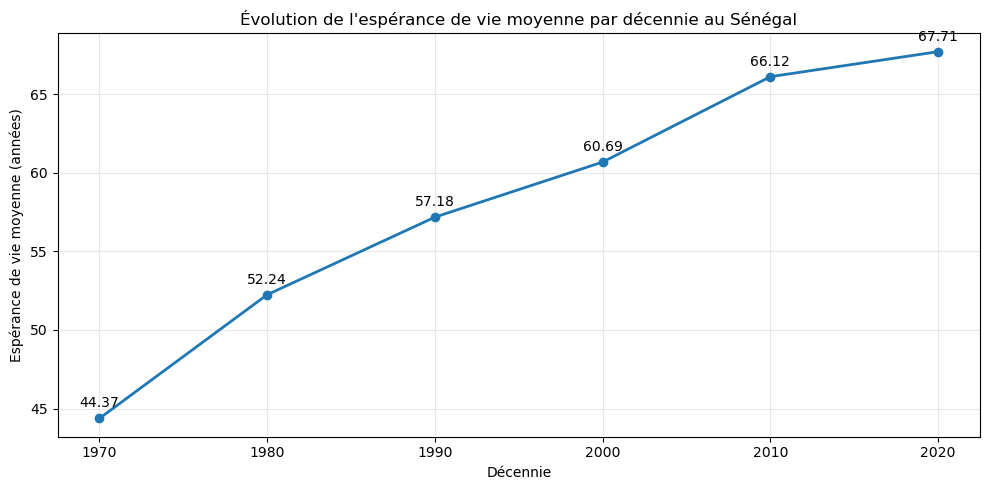
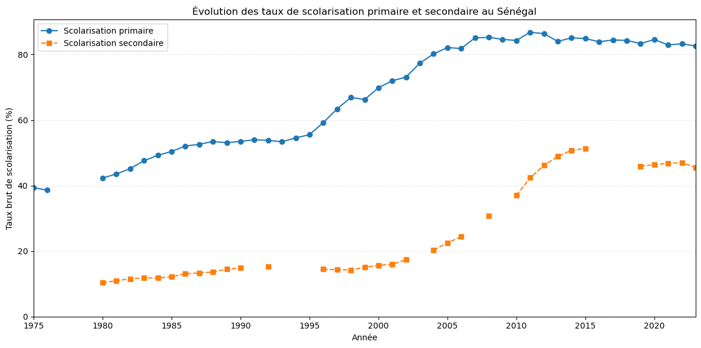
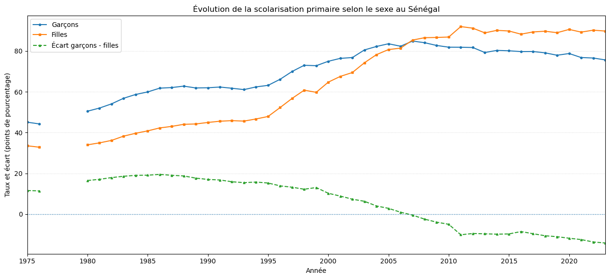
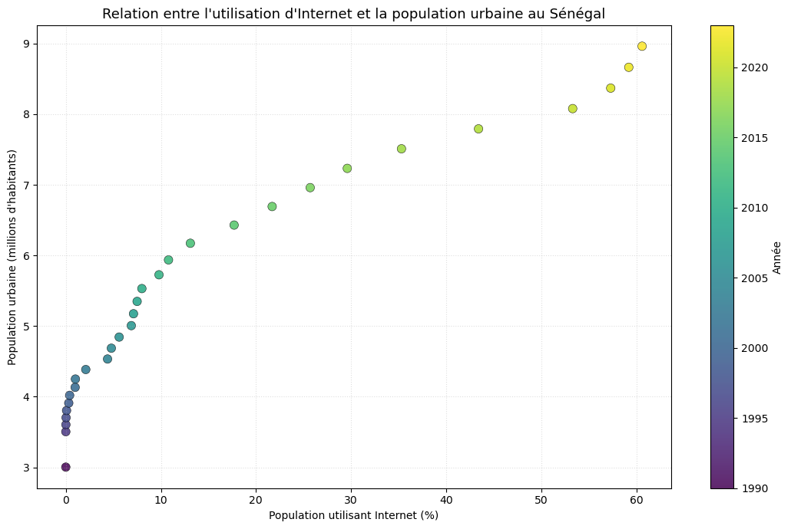

# 🇸🇳 50 ans d’évolution du Sénégal : une analyse exploratoire des données (1975–2023)

**Projet d’analyse de données réalisé dans le cadre du challenge FORCE-N sur Zindi — Cohorte 3.**

Comment les données peuvent-elles nous raconter l’évolution du Sénégal au cours des cinquante dernières années ?

C’est la question au cœur de ce projet. À partir d’indicateurs socio-économiques issus de la Banque mondiale, ce travail explore plusieurs décennies de transformations du Sénégal à travers quatre grands axes : la démographie, l’économie, la santé et l’éducation, ainsi que les infrastructures et les technologies.

L’objectif est de transformer des données brutes en informations compréhensibles, de mettre en évidence certaines évolutions et d’identifier les relations entre différents indicateurs.

---

## 🎯 Objectifs du projet

Ce projet vise à :

- Explorer et comprendre un jeu de données historiques sur le Sénégal.
- Préparer les données nécessaires à l'analyse.
- Répondre à 13 questions analytiques portant sur les évolutions démographiques, économiques et sociales du pays.
- Identifier des tendances et des relations entre indicateurs.
- Construire des visualisations pour faciliter l'interprétation des résultats.
- Communiquer les conclusions de manière claire, en tenant compte des limites des données disponibles.

## 📊 Données utilisées

Les données proviennent des indicateurs de développement de la **Banque mondiale**, mis à disposition dans le cadre du challenge FORCE-N sur Zindi.

Le jeu de données est organisé dans une base SQLite contenant 26 variables, notamment :

| Domaine | Exemples d'indicateurs |
|---|---|
| Démographie | Population totale, population masculine et féminine, population urbaine |
| Économie | PIB par habitant, inflation, exportations, importations, chômage |
| Santé | Espérance de vie, dépenses de santé |
| Éducation | Taux de scolarisation primaire et secondaire |
| Technologie et infrastructures | Accès à l'électricité, utilisation d'Internet, abonnements mobiles |

**Période étudiée :** 1975–2023  
**Nombre d'années disponibles dans la période d'analyse :** 46  
**Nombre de variables :** 26

La base source contient également une observation pour 2024, mais celle-ci n'est pas intégrée à l'analyse afin de respecter la période définie par le challenge.

### Qualité et préparation des données

Une attention particulière a été accordée à la qualité des données avant leur exploitation :

- Exploration de la structure de la base et des variables disponibles.
- Vérification des années couvertes et des observations.
- Identification des valeurs manquantes.
- Sélection des observations pertinentes pour chaque question.
- Vérification de la cohérence des calculs et des indicateurs dérivés.

Les valeurs manquantes n'ont pas été remplacées arbitrairement. Les analyses sont réalisées sur les observations disponibles pour chaque indicateur ou paire de variables. Le nombre d'observations peut donc varier d'une analyse à l'autre.

---

## 🔎 Les 13 questions explorées

L'analyse s'articule autour de 13 questions réparties en quatre axes.

### 1. Population et démographie

- Quelle est l'évolution de la population sénégalaise ?
- Quelle est la différence entre la population masculine et féminine ?
- À quelle période cet écart est-il le plus important ?

### 2. Économie

- Quel est le PIB moyen par habitant entre 2000 et 2020 ?
- Quelle année présente le taux de chômage observé le plus élevé ?
- Comment le PIB par habitant évolue-t-il au fil du temps ?

### 3. Santé et éducation

- Comment l'espérance de vie a-t-elle évolué au fil des décennies ?
- Comment les taux de scolarisation primaire et secondaire ont-ils évolué ?
- Quelle relation existe-t-il entre les taux de scolarisation primaire et secondaire ?
- Comment l'écart de scolarisation entre les filles et les garçons a-t-il évolué ?

### 4. Infrastructures et technologies

- Quelle relation observe-t-on entre la pénétration d'Internet et la population urbaine ?

---

## 📈 Principaux résultats

Voici quelques résultats marquants issus de l'analyse.

### Évolution de la population

Entre 1990 et 2020, la population du Sénégal est passée de **7 720 523 à 16 789 219 habitants**.

Cela représente une augmentation de **9 068 696 habitants**, soit une croissance globale d'environ **117,46 %** sur la période.

### Espérance de vie

L'espérance de vie moyenne observée progresse au fil des décennies :

| Décennie | Espérance de vie moyenne |
|---|---:|
| 1970 | 44,37 ans |
| 1980 | 52,24 ans |
| 1990 | 57,18 ans |
| 2000 | 60,69 ans |
| 2010 | 66,12 ans |
| 2020–2023 | 67,71 ans |

Les périodes 1970 et 2020 sont partielles : elles ne couvrent respectivement que deux et quatre années disponibles.

### PIB par habitant

Entre 2000 et 2020, le PIB moyen par habitant observé est de **1 165,79 dollars**.

Cette moyenne décrit un indicateur économique rapporté à la population. Elle ne représente pas le revenu effectivement perçu par chaque habitant.

### Chômage

Le taux de chômage observé le plus élevé dans les données disponibles est de **6,757 % en 2015**.

Ce résultat doit être interprété en tenant compte des années pour lesquelles les données sont disponibles.

### Éducation et scolarisation

L'analyse met en évidence une progression des taux de scolarisation primaire et secondaire sur les périodes observées.

La corrélation de Pearson entre les deux indicateurs est de **0,8408**, calculée sur 34 observations communes. Cela traduit une forte association positive entre les deux séries à l'échelle annuelle.

L'analyse de l'écart entre les taux de scolarisation des garçons et des filles révèle également une évolution intéressante : l'avantage initialement observé chez les garçons s'inverse au cours des années 2000.

### Démographie et écart entre les sexes

En 2023, l'écart absolu entre la population masculine et féminine atteint **318 045 personnes** :

- Population masculine : 9 197 809
- Population féminine : 8 879 764

### Internet et urbanisation

La relation entre l'utilisation d'Internet et la population urbaine présente une corrélation de Pearson de **0,9488**, calculée sur 30 observations communes.

Cette forte association indique que les deux indicateurs évoluent dans le même sens sur la période étudiée. Elle ne permet toutefois pas de conclure que l'urbanisation entraîne directement une hausse de l'utilisation d'Internet.

---

## 📉 Visualisations

Les graphiques réalisés permettent d'examiner les principales tendances et relations observées.

### Espérance de vie par décennie



### PIB par habitant et espérance de vie


### Évolution de la scolarisation primaire et secondaire



### Écart de scolarisation entre filles et garçons



### Relation entre urbanisation et utilisation d'Internet



---

## 🧰 Outils et technologies

| Outil | Utilisation |
|---|---|
| Python | Exploration et analyse des données |
| SQL | Interrogation et extraction des données |
| SQLite | Stockage et consultation de la base de données |
| Jupyter Notebook | Environnement de travail et documentation de l'analyse |
| Visualisation de données | Représentation graphique des tendances et relations |

---

## 📁 Structure du projet

```text
force-n-evolution-senegal-data-analysis/
│
├── data/
│   └── raw/
│       └── senegal.db
│
├── fig/
│   ├── PIB&Esperence_de_vie_fidèle_Q7.png
│   ├── evolution_esperance_de_vie_Q3.png
│   ├── evolution_scolarisation_prim-VS-sec_Q8.png
│   ├── evolution_scolaristion_fidele_Q10.png
│   └── relation_popurb_internetUsage_Q13.png
│
├── notebooks/
│   └── 01_decouverte_des_donnees.ipynb
│
├── variable_descripton.csv
│
└── README.md
```

---

## 🚀 Explorer le projet

Pour consulter le travail :

1. Ouvrir le dossier `notebooks/`.
2. Consulter le notebook `01_decouverte_des_donnees.ipynb`.
3. Parcourir les différentes étapes de l'analyse, les requêtes, les calculs et les visualisations.
4. Consulter le dossier `fig/` pour retrouver les graphiques exportés.

Pour exécuter le notebook localement, il est nécessaire de disposer de Python, de Jupyter Notebook et des bibliothèques utilisées dans le notebook. La base SQLite est disponible dans `data/raw/`.

---

## ⚠️ Limites de l'analyse

Les résultats doivent être interprétés en tenant compte de plusieurs limites :

- Certaines années ne disposent pas d'observations pour tous les indicateurs.
- Les périodes couvertes varient selon les variables.
- Les analyses de corrélation mettent en évidence des associations statistiques, mais ne démontrent pas de relations de causalité.
- Les taux de scolarisation bruts ne correspondent pas nécessairement à la proportion d'enfants ayant l'âge officiel de scolarisation effectivement inscrits.
- Les moyennes calculées sur des décennies incomplètes doivent être interprétées avec prudence.

Ces limites font partie intégrante du travail d'analyse : elles permettent de distinguer ce que les données montrent réellement de ce qu'elles ne permettent pas de conclure.

---

## 🎓 Contexte du projet

Ce travail a été réalisé dans le cadre du **challenge FORCE-N sur l'analyse de données — Cohorte 3**, organisé sur la plateforme Zindi.

Au-delà des réponses aux questions du challenge, ce projet constitue une mise en pratique de compétences en exploration de données, SQL, analyse statistique, visualisation et communication des résultats.

**L'idée centrale : utiliser les données pour mieux comprendre les transformations du Sénégal et raconter, à travers les chiffres, une partie de son histoire.**
